# Developer Diary

## Entry 1: 21 September - 28 September
This week was the first week of work for this assignment. To make sure that I didn't waste time iterating for no reason while coding, I made sure my planning was well constructed in advance. Which is why I spent the entire week focusing purely on the 4 steps of the planning stage. These steps being - `Understanding The Problem`, `Identifying the Inputs & Outputs`, `Worked Example`, and `Pseudocode`.

For the first step, since this assignment has no set objective to complete, I thought hard about what I wanted to create. I wanted to make something that isn't just a simple currency converter or spending-category summariser. I wanted to make something that I would actually use. Which is when I realised that I have actually used Gemini in the past to inform me on what the best car for me was based on my finances and my goals for the future. That chat itself had a lot of variables and had complex factors to take into account, which would be too hard to integrate into a Python application like this for me at my skill level. So I made a simpler generic version which accomplishes the same goal. The program allows users to see if a purchase is financially feasible for them based on their income and the expenses they have.

After defining what I wanted the program to do, I moved onto defining what the user is meant to do and see. Here is also where I got stuck on how I should format the notebook file. I wondered whether having all my planning at the start is the best, or having text blocks with each of the 3 sections before it's respective code block is better. I decided to go with the first one as it feels more concise and tidy. Reading through all of it gives both me and anyone else reading this file an easy glimpse into how this program works from start to finsish, without having to scroll through the entire notebook.

Moving onto the worked example and the pseudocode, I heavily underestimated how long it would take me to iron out everything I wanted to do. Initially, I thought it would take a day to get through it all as it should be a simple enough program to create. However, after going through the worked example with the current variables I made, I realised that I would need to change things around. Some things include me not factoring in people's savings and current bank balances, and whether someone would even want their savings accessed for non-essential purchases. Which then tied into me not properly calculating the risk_tier of the purchase, as I wasn't considering their current bank balance and was only looking at how much money they would make at the end of the year if they maintained their average income. There were other stuff I also had to iterate over heavily, and it made me happy to see that this planning stage truly was very useful.

Parts of the pseudocode and overall planning may not directly align with the code that I create, and that is mainly because I created this planning with the intention of it being an overview of the logic of the program, and not a super in-depth breakdown of the program. So even though I have planned all of the functions, there are still things I am going to change that I may not include in the pseudocode. For example, parts of the program may not translate 1:1 into the Python version, like how I say:
> ITERATE through payslip:
>
> IF payslip.wage_time_frame EQUALS 'week':
>
This technically doesn't make sense if converted to Python, as `payslip` is an array and doesn't have a wage_time_frame field. But it still gives me 95% of what I need, and I understand what it's actually trying to say.
Additionally, my pseudocode is written from the point of view of it being a terminal program. Despite it being a Gradio program, since I don't know Gradio at this point, I just wanted to make it more terminal based as that makes sense to me and I can see what may need to be validated and what the flow of the program is.

Regarding AI usage this week. I only used Gemini when seeing what my output would look like with my custom prompt. I used the same prompt twice, but chanced the value of `savings_can_be_accessed` to true and false. For other parts of the program, I didn't need AI as I already knew exactly what I wanted this program to be, and I didn't need AI to tell me how it should work. I will most likely use it more next week when I get into the actual coding part.

**This is what Gemini gave me this week:**
- When I put poor financial information into the prompt, it said this:
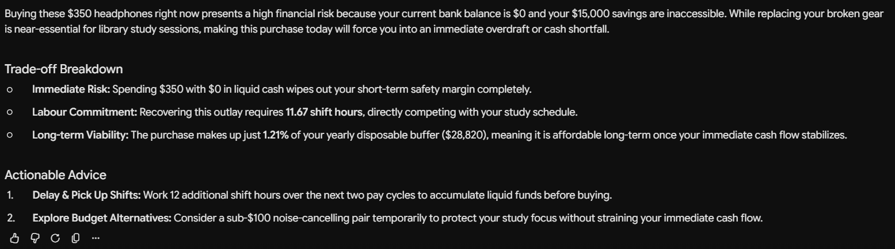

- When I put good financial information into the prompt, it said this:
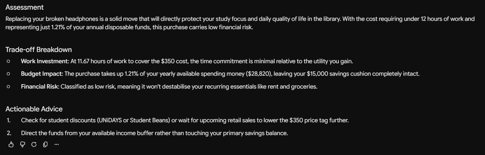

I think that this response is pretty good, as it is concise, isn't hallucinating information, and analyses the situation. Although I may change it in the future anyways.

 

---

 

## Entry 2: 28 September - 04 October
This week I actually started working on my code. I used the pseudocode I had made last week as a guide as to what I wanted to build, and because of that, it was very easy to get started.

Since Gradio is an actual display with pre-defined components, and isn't the normal terminal that I am used to, my pseudocode wasn't a 1 to 1 match, but it gave me what I needed to know.
To get started, I looked up Gradio documentation, as I didn't want to rely on AI immediately. Initially I used the [quickstart guide](https://gradio.app/guides/quickstart), however when I tried to make the program more complex, I didn't know what to do and how to use Gradio to achieve what I wanted. Still reluctant to run to AI, I came across this this website which showed how to put together more [complex components](https://gradio.app/guides/dynamic-apps-with-render-decorator#putting-it-together). When play-testing on the website, I could see that this is the exact functionality I wanted, however I didn't understand any of the code and how to make it mine. This is where I then went to Gemini.

I pasted the code into Gemini and asked it to explain each line of the code and how it worked.
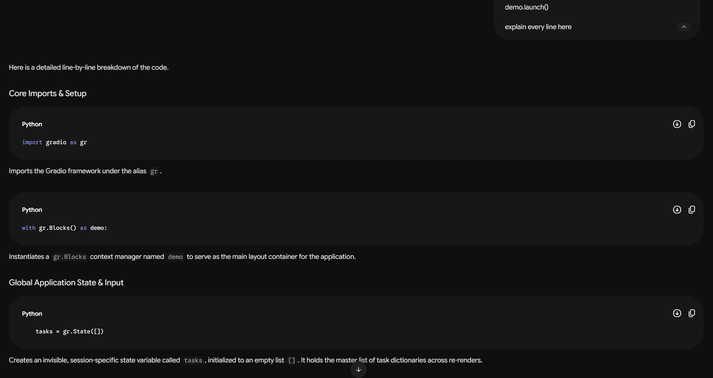
This allowed me to actually see how the program functions and how I can use it.

However, since I'm new to Gradio, I still didn't understand much about the code. So I would ask Gemini for further clarification on how things worked
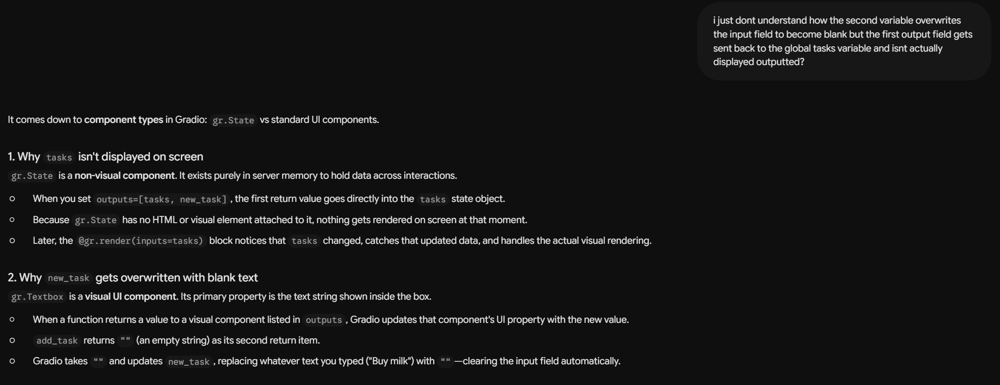

And when I begun to get the handle on things, I gave it my own explanation of how the code works, to see if I truly do understand it.
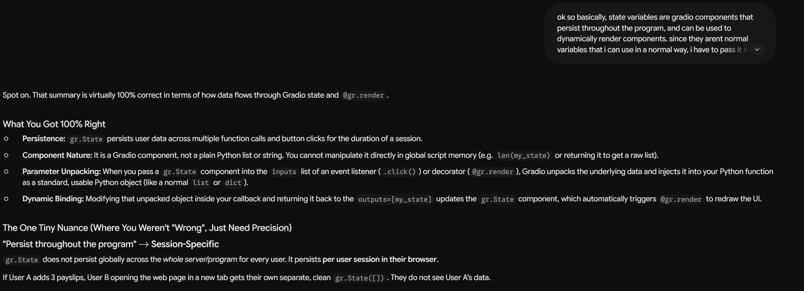
This provided reinforced learning and allowed me to be fully confident that I can work through the program.

I didn't ask it to write any of the code for me as I didn't need to. Once it explained to me how the code worked, I was able to make my own code. After finishing it, I then verified with it that everything was working. I asked it to go through my code and give me a summary of what I did well, and what I need to improve on.
An example of something it told me to improve on, was it telling me to add a guard at the start of the code.
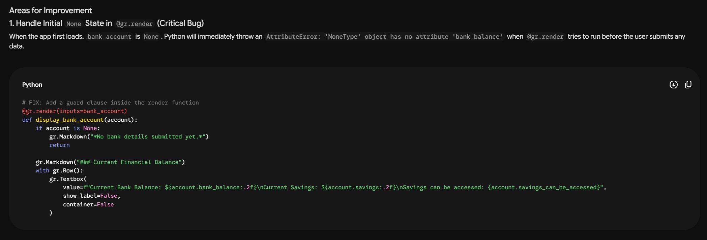
Despite it being probably being correct, I haven't experienced any issues with my current setup, so I have no reason to change it to what it's telling me. I also purposefully made the object null so that it would render an empty space. However, if in the future I hate the design I made, I may add the guard to have it display a message.

All in all, Gemini has been very helpful this week in explaining the code, and has fully enabled me to write my own code rather than rely on it for everything.

 

---

 

## Entry 3: 11 October
This week didn't have much work to be done, but I still got through a major chunk of the assignment.
The last thing I completed were the initial components for the Gradio interface, but I stopped there as I couldn't figure out how to properly read the user's data and do calculations on it. Since the user can just edit their data, I thought "how will the calculations know to take in the correct data?"

But then it hit me today that I should just make a button so that the user can click it and submit all the finalised information they have uploaded.
I don't know why it took me this long to figure that out but that is what I did this week.
I created a button that when clicked, submits all of the user's data, and calculates financial data using 3 functions:
- calculate_income()
- calculate_personal_finances()
- calculate_item_impact()

This data is then put into a User_Data() object and is used for the financial summary and impact analysis display.

A key thing about the calculation section is that I force the user to input an item that they want to purchase, as the point of the program is to determine if this purchase is feasible. However, I don't force the user to put in any expenses or have any money in their account. I gracefully handle those by putting in default values for the bank account information, and just let the expenses be an empty array. When first conceiving this section, I also made the payslips array optional too, however I soon changed this as the program is designed for people who work shift based jobs. And allowing a user to have no income, no money, and no expenses didn't seem right. I also enforced a minimum of 0.1 for the number of hours worked and the hourly rate because otherwise the user could just put 0, which essentially makes the payslip section optional again.

Overall, it was very easy to implement these sections once I figured out what to do. This was mainly due to me being able to essentially copy and paste my pseudocode and translate it into Python.

Regarding my AI usage, due to the simplicity of the functionalities I completed, I didn't need to use much AI.
I only used it twice, once when showing it my code and asking it what it thought, and a second time when asking it about error handling for my code.

I submitted all of my initial code and plans for the calculation and display functions, and it outputted the following code back to me as an **improved and streamlined** version of my code.

When I read through this, I immediately found it incomprehensible and difficult to read, and I didn't understand how it was streamlined. It essentially does the same thing of doing calculations and displaying the data once a button is pressed. Just in a messier and less modular way. Due to that, I didn't bother with trying to integrate anything it gave me as I didn't need to. My code worked perfectly fine according to what I wanted, and I was able to read it well.

The next time I used AI was to figure out how to get warning messages to properly display when the button is clicked.
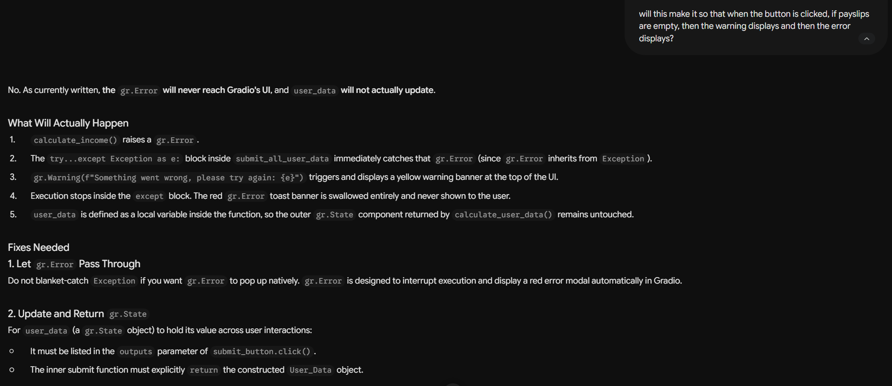
The initial explanation helped a bit, but reading the code allowed me to actually understand what was happening.

In the code, I could see that the gr.Error() component was being raised if something bad happened. I had been putting the error component within the exception block and was confused as to how to throw exceptions on demand. So this AI output was actually quite helpful. It also suggested I raise an error for all 4 inputs, however I rejected that due to my aforementioned reasoning of allowing the user to have no money and expenses.
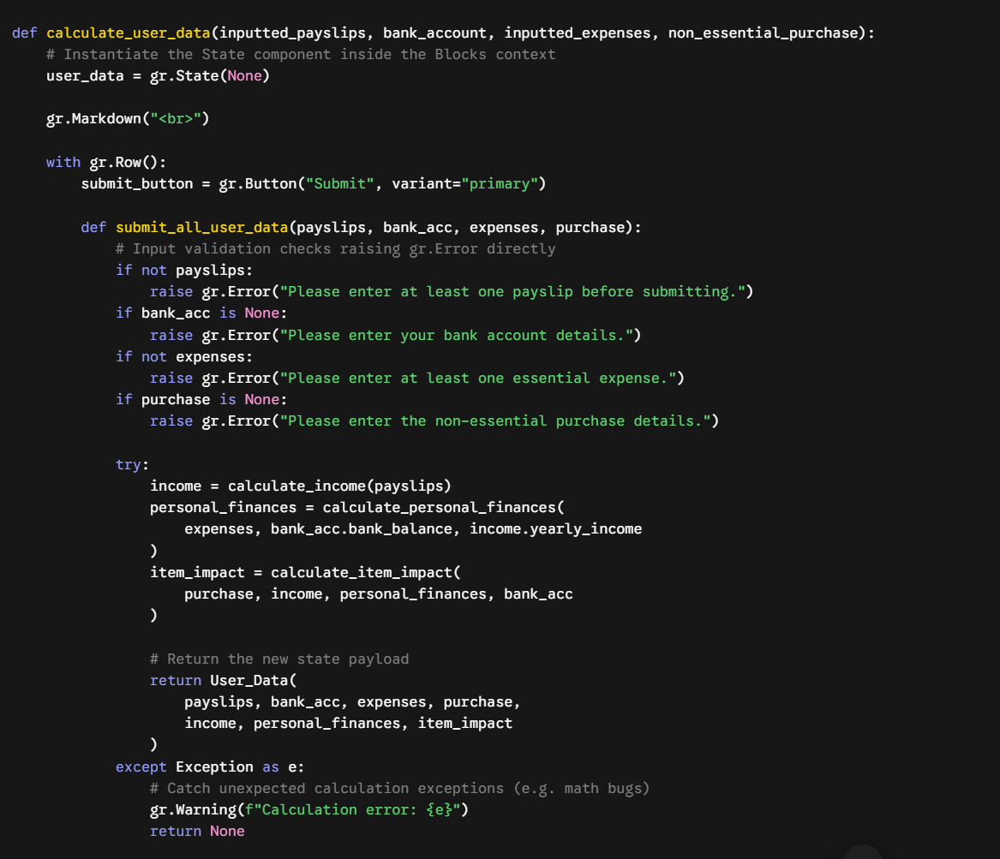

All in all, today was very productive, and I intend to continue this momentum by finishing off the AI Assistant display and writing the test cases.

 

---

 

## Entry 4: 12 October
Today I mainly focused on starting the test suite. I made 3 test functions for my backend calculation functions, and a wrapper to call them all.
To get started with testing, I made a single fully formatted test, and then I pasted it into Gemini and asked it to generate me more tests following that format.
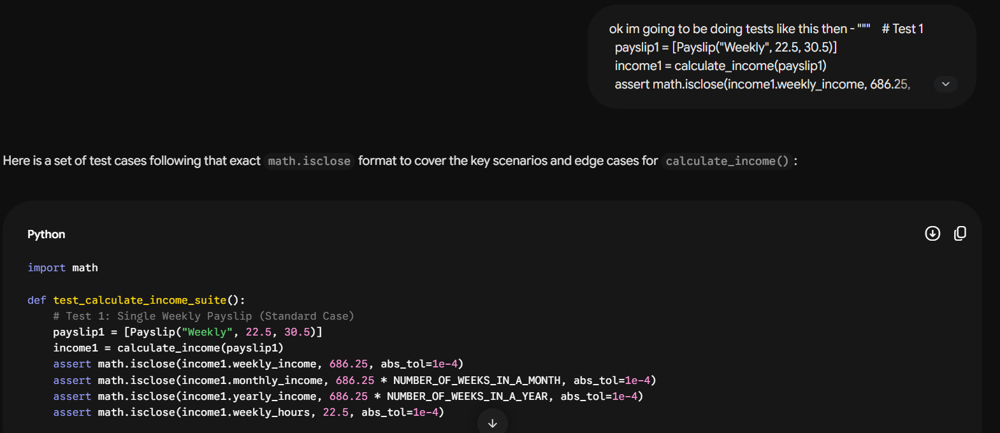
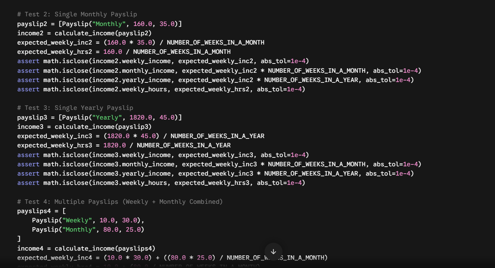

Reading through these test cases, I realised one common thing between all of them. They all followed the same formulas and format.
Me thinking that I am a genius, I suggested to Gemini to replace all the hardcoded values with the variables themselves. So instead of writing `30 * 25`, the test would now write `payslip2[0].hours_worked * payslip2[0].hourly_rate`.
Gemini didn't object at all when I suggested this and replaced all of the tests with this new format.
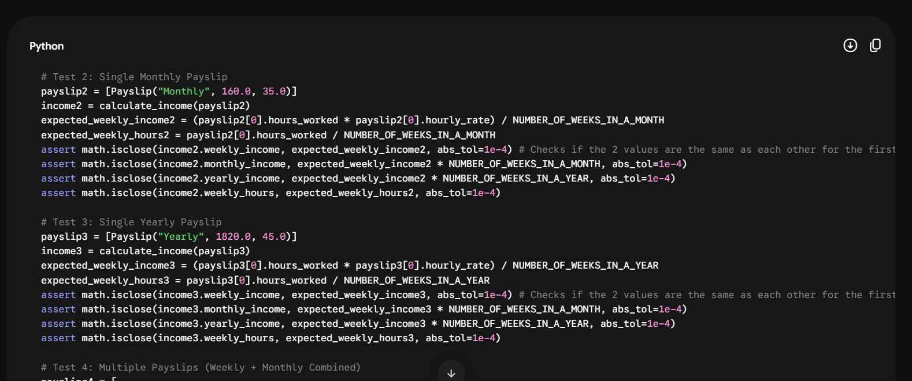

I then used this same strategy in making the next function's test cases.
 test")

This is then where it hit me that this may not actually be the best way to make test cases. I had realised that I wasn't actually testing anything. I was just regurgitating what the formula already calculated.
The tests were passing due to the fact that I was just repeating the contents of the formula that I was supposedly *testing*, by using the variables and formulas directly.
What I actually needed to do was use hardcoded numbers that are pre-calculated and then placed into the test, to see if what the function gives me, is the same as what **I calculated!!**

I brought this up with Gemini, where it finally told me that what I was doing, was an anti-pattern called tautological testing. I then looked up the definition and read - *Tautological Testing checks that code executes or matches itself instead of proving that the code produces the right output.* This is **exactly** what I had been doing, and so I changed all of my tests immediately.
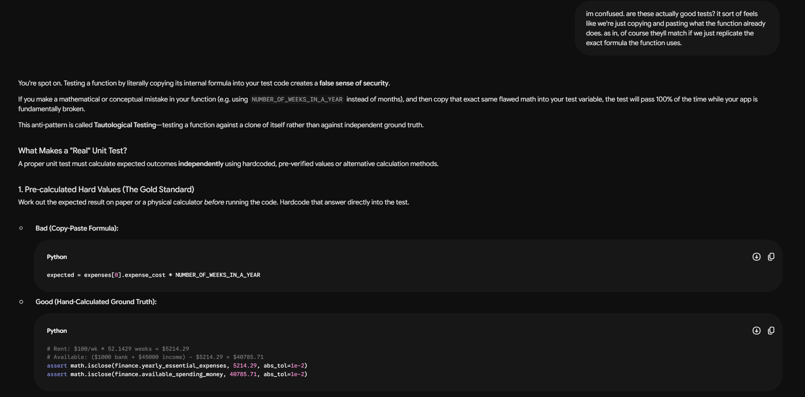

I had Gemini re-make my test cases with hardcoded variables so that the function was actually being tested properly. I read through each test to make sure that it made complete sense, and edited parts of how it looked.
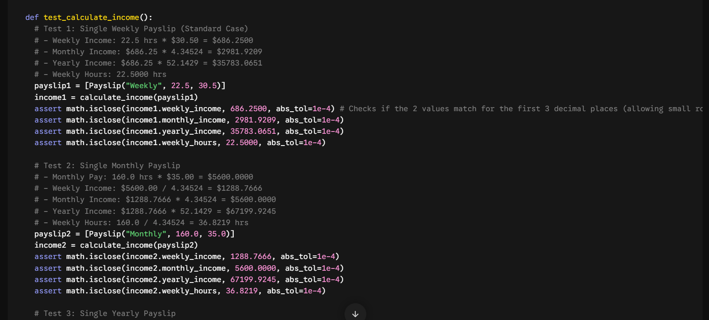

I also had to edit some results as it had given me incorrect answers to some asserts, causing the tests to fail.
But once I had fully scanned through them all, I was satisfied and saved my work for the day.
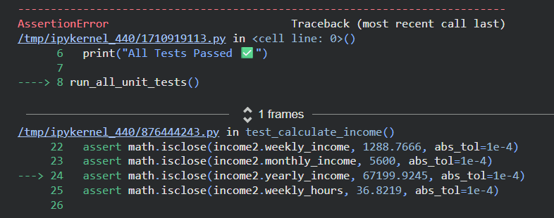

 

---

 

## Entry 5: 13 October
Today I continued on with making more tests, as well as fixing up some validation that I forgot to implement earlier. When running through the tests for `calculate_income()`, I realised that I wasn't testing the `time_frame` at all, and that any test on it would completely break it in its current state.
Despite it being fully formatted before it even arrives to this point, I thought that I may as well handle it since it would only take a few lines of code.
When doing the comparisons, I removed all whitespace from the string and lowercased it. Then when it was ready to be shipped off, I capitalised it again.
I did the same thing within the `calculate_personal_finances()` function too as it was also missing proper validation.

After doing all this, I started to heavily contemplate whether I should also do the same for the numbers, and add a guard to ensure that the number isn't negative. However I was unsure as to how this would even work within the program. The front-end completely filters negative numbers out so it's impossible for one to get through. But regardless of all of this, I still decided to implement it as it just felt right to do so. I made it so that it would continue onto the next index in the list and not process the invalid value if the value was was too small.
I asked Gemini what it thought, and it said to not include the guard, but I disregarded that advice and added one anyways, because if I'm going to add a guard for the `time_frame` string, I may as well add one to the number values too. These paths should never be entered during normal usage, but I thought that there should still be some check regardless.
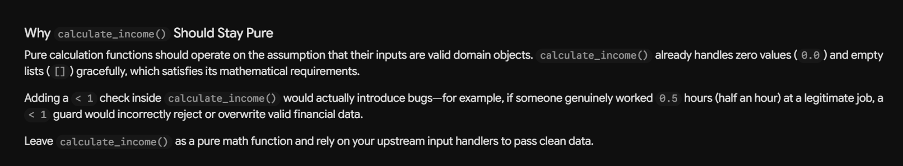

 

---

 

## Entry 6: 14 October

Today I finished up my test suite by getting Gemini to go through 3 documents I found on blackboard, and having it make test cases for every single path that I could think of.

Another thing I noticed when making these tests was that my function signatures had parameters for each field of the `Bank_Account` object, when it could just have the variable for the object itself to reduce the number of parameters being passed in.
I also noticed that I had been making the impact_ratio become 100% immediately if the user had no money, which made sense. However I was also doing this even when the item was free, which didn't make sense, so I reworked that logic.

Regarding the actual tests themselves, I had Gemini read some documents on how to make good test cases and I asked it to follow those instructions and write out tests that covered every possible pathway.
As I was reading through the tests, I thought it had done a really good job, until I saw that there were 19 test cases just for one function. I then re-read them and saw that many of them were very similar to each other, and that a lot of them could easily be removed.
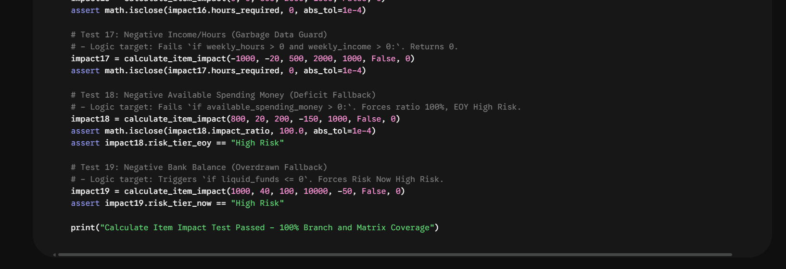

So I asked Gemini to consolidate similar tests into each other, and to highlight what boundary or edge or situation is being tested.
And only then did it output a comprehensive list of tests that weren't extremely redundant.
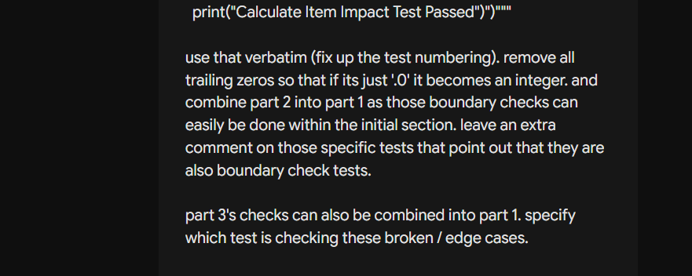
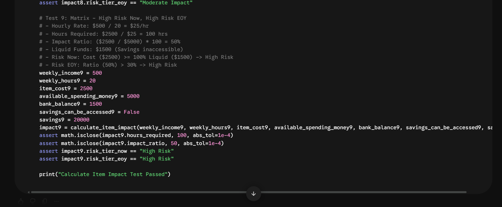
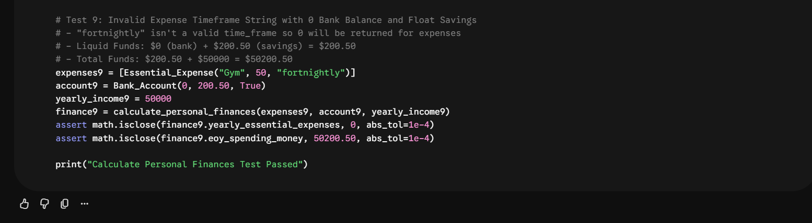

At this point, Gemini had fixed up all of my tests for me. I read through them all and decided to stick with them as they seemed to cover every path that I could imagine.I did see that some tests didn't use the `savings` field very well, but I just manually tweaked those tests myself.

Outside of testing, when running my Gemini API call, I kept receiving 503 errors. And at this exact moment, I see a post with code about how to have it retry the call. So I implemented it, and it worked perfectly. It was also very human readable so I didn't need Gemini to understand what was going on.

 

---

 

## Entry 7: 16 October
Today I went through the code, finalised it all, and ensured that everything was working perfectly.
The major thing I worked on was fixing some validation within the CSV reader, as I had only noticed now that it didn't check for whitespaces and casing properly.
I also went through the code and made any duplicate code into reusable functions and implemented dictionaries instead of if-statement-chaining for 2 of the calculation functions.

Previously I had been using the `max()` function to ensure that all inputs were a certain value, however it didn't feel right when testing it. So instead I made a warning appear if an invalid input is entered, and put this logic into the `validate()` function. This makes the code much cleaner to read and write. Additionally, while I was tinkering with the input validation, I decided to change the minimum from 0.1 to 1, as 0.1 just felt weird. 1.0 felt like a more standard minimum to use, so I changed everything everywhere to accommodate for this, and the application felt more intuitive after this change.

Finally, I noticed that the prompt I was using for Gemini was very strict and gave a similar response each time. So I added more to it to have it be more varied in its responses and to take more factors into consideration, such as the price of the item and if it's legitimate or not, as well as not being so harsh if the user is $1 short of the purchase.

Regarding my external use of AI, I didn't have to use Gemini for much today. I only really used it at the end when asking it if I had completed everything successfully, and if there were any inconsistencies or bugs still present. It told me that my regex was incorrect as I was preserving the minus-sign, however this is actually on purpose. If I ignore the minus sign and have it cleaned, then `-15`, would become `15`, and that could mess things up if the user didn't mean to put `15`. I ensure the minus-sign is kept so that all negative numbers pass through and then are filtered within the if-statement check afterwards.
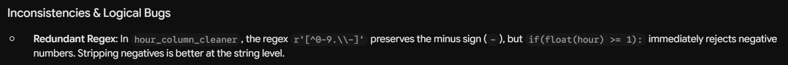

So having rejected that bit of Gemini advice, it then told me that I passed everything. This I do agree with, since from what I can see, everything looks to be working as intended, and all the tests I have conducted have passed.
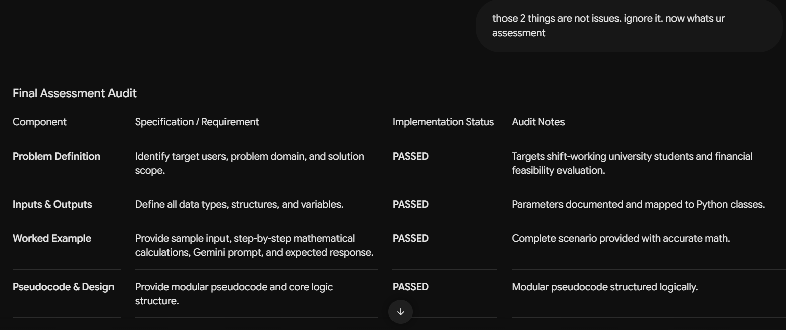