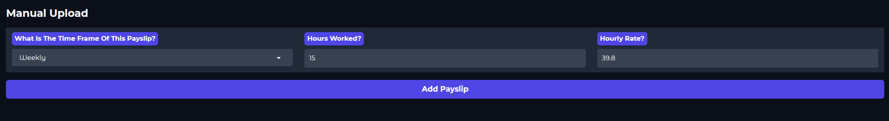
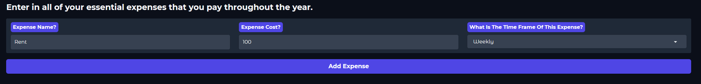
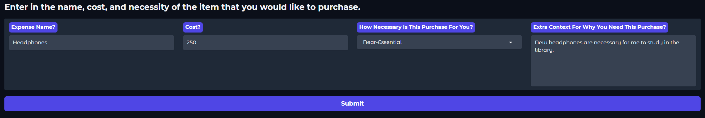
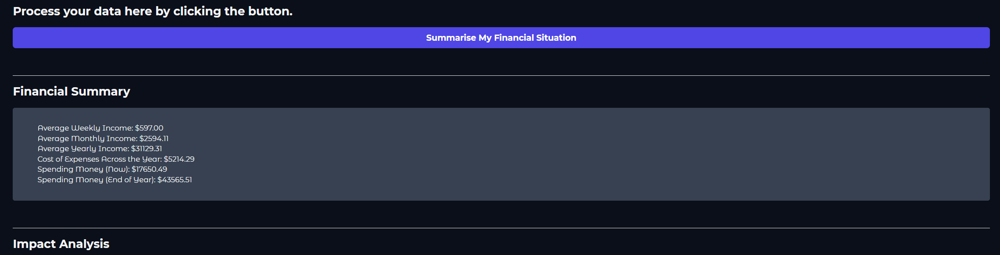
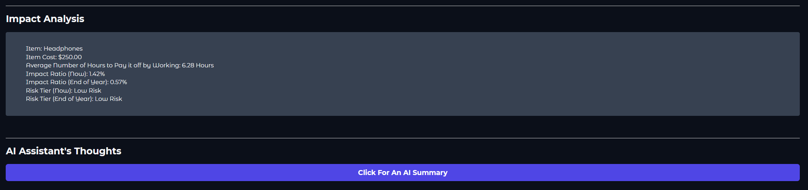
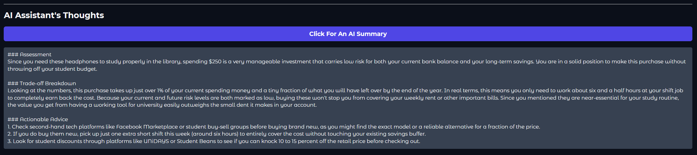

## What The Program Does:
This program is an interactive financial assistant designed to help university students who work shift-based casual jobs better understand their finances.
University students who work these jobs may struggle to evaluate how much they actually make a month and whether or not a desired purchase is financially viable for them.
Thus this program will allow them to enter in a variety of data and see if it is feasible to purchase something that they want.
Everything outputted from here is pre-tax to keep the financial modelling simple and accessible to everyone.
There are also other things that aren't being taken into consideration to keep it all simple such as large debts (like university debts), having negative savings, superannuation, and planned purchases in the future.
There is also an arbitrary minimum of 1 for most input fields as this felt like the smallest-realistic number that someone should be entering into this system.

**The key features include:**
- Calculates the user's total income via manual input or CSV payslips across weekly, monthly, and yearly time frames.
- Calculates the total liquid funds the user has access to as well as how much they'll have to spend on essential expenses.
- Calculates the short and long-term risk and impact in buying the item.
- Displays the user's inputs as well as the calculated data across bullet points
- Allows the user to input this data into Gemini via an API call. Gemini will then output a response based on the data as well as a strict prompt (so that it doesn't hallucinate or go off-topic).

 

---

 

## Sample Inputs:
- The following images show sample inputs for all of the input fields of the program.
- There is no screenshot for the CSV section but that does not mean it is inaccessible to use if manual payslip data is inputted. Both can be used at the same time, but for the purposes of this demo, only the manual section has been used.
- The lists that store the payslip and expense data can also store more than one item, but for the purposes of this demo, only one entry is shown.

#### Sample Payslip CSV
Wage_Time_Frame,Hours_Worked,Hourly_Rate
Weekly,15,39.8
Weekly,4,26.6
Monthly,40,32.5

##### Sample Payslip Input

##### Sample Bank Account Input

##### Sample Expense Input

##### Sample Purchase Input

 

## Sample Outputs:
- The following images show what the outputs would be like for the above data.
- Do note, that the Gemini Output may vary between usages as Generative AI is non-deterministic and won't give the exact same response each time.
- Unlike the 2 summaries, which will show the same output if the same input is given.
- Take all the output at your own discretion, as even with all of this data, there are still many more factors that impact financial decisions.
- Simply use it as a guide.

##### Sample Financial Summary Output

##### Sample Impact Analysis Output

##### Sample Gemini Output

 

---

 

## How To Run It:
**To run the program, complete the following actions:**
1. Open the `Assessment_2_Programming_Project.ipynb` Notebook.
2. Open it in [Google Colab](https://colab.research.google.com/github/JuanJoboy/Introduction-to-Business-Programming/blob/main/Assignments/Assessment_2_Programming_Project.ipynb#scrollTo=AWcTfiAAEycl)
3. Click on the `Run All` button at the top.
4. Scroll down the file until you reach the `App` section.
5. Enter in the relevant data into the input fields.
   1. Note that not every field needs data.
   2. The only required pieces of information are the details about your purchase, as well as at least one payslip.
   3. Although, adding more information will definitely contribute to a more accurate representation of your situation.
6. Click the `Summarise My Financial Situation` button to read the summary panels.
7. Clicking that button will then give you access to click the `Click For An AI Summary` button.
   1. Clicking this will provide you with an AI summary.
   2. This summary is generated by Gemini's generative AI so it may not be 100% accurate.
   3. To get another AI summary, simply re-click the button again.
8. To redo the program, either click `Run All` again, or go through each of the fields that you want to update, and submit the new data that you have.
   1. This new data will either overwrite the current input if it's for the Bank Account or Desired Purchase sections.
   2. Or it will add it to the list if it's for the Payslip or Expense sections.
      1. To remove data from these lists, either press the `Delete` button, or press the `Clear All` button.
9. To run the `Unit Tests`, simply scroll all the way to the bottom to see the tests and their outcome.

**API Key:**
- If you require a Google API key, you can obtain one from [Google AI Studio](https://aistudio.google.com/prompts/new_chat).
- Then once you have the key, open the `Secrets` panel on the left of Google Colab.
- Enter the `key` into the `Value` field, and enter `GOOGLE_API_KEY` into the `Name` field.
- Enable `Notebook access`.
- Re-run the program by going back to `Step 3` above.

**CSV Notes:**
- Ensure that before you upload a CSV, it is fully readable by the program. Otherwise it will be rejected.
- **The requirements for CSV uploads are:**
    **Column Headers:** Wage_Time_Frame, Hours_Worked, Hourly_Rate
    **Wage_Time_Frame values:** Weekly, Monthly, or Yearly
    **Hours_Worked:** Positive number (minimum 1.0)
    **Hourly_Rate:** Positive number (minimum 1.0)
- The program will do its best at trying to clean up slightly broken bits of data, however if a piece of data is *too invalid*, then the entire CSV file will be rejected and none of the data will be uploaded.
- The same goes for the other input fields in the program. If your input isn't valid, a pop-up will appear telling you that what you just entered was invalid, and why it was invalid.

 

- **Additionally, regarding the payslip information, please note that each payslip will be within the same time frame.**
- What this means is, if you input 2 weekly rows and a monthly row, the program will believe that you are getting paid twice in a week, and on top of that, also monthly. This would make your yearly salary equal `(12 * monthly amount) + both weekly amounts * 52`.
- And with there being both the option to add a payslip via CSV, or via manually inputting it, the program will use both inputs to create a master list of payslips if information is submitted in both areas. To prevent double-dipping, please either use one or the other, or be careful if you plan on using both.